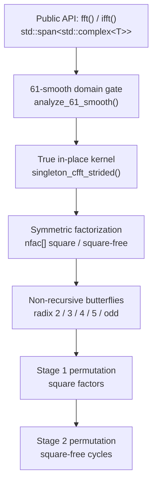

# MosaiQ-Singleton-FFT: Complex Mixed-Radix Algorithm Structure

**Status:** Architecture Specification (v2.0)  
**License Holder:** BonaSapiens Inc.  
**Scope:** Non-recursive, true in-place Singleton mixed-radix FFT over the 61-smooth prime radix domain.

---

## 1. Architectural Overview

`MosaiQ-Singleton-FFT` implements an in-place complex fast Fourier transform over composite lengths \(N\) whose prime factors do not exceed 61. The engine is a faithful C++20 translation of R. C. Singleton (1968) / I. G. Kim (2006, 2012) `cfft.F`:

1. Symmetric square / square-free factorization of \(N\).
2. Non-recursive mixed-radix butterfly passes (radices 2, 3, 4, 5, and generic odd primes through 61).
3. Two-stage cycle-following permutation restoring natural order.

There is **no** recursive Cooley–Tukey / KissFFT stage stack and **no** \(O(N)\) data scratch buffer. Auxiliary workspace is bounded by \(O(\mathrm{maxf} + \mathrm{maxp})\).

The forward transform is defined as

\[
X_k = \sum_{n=0}^{N-1} x_n \exp\!\left(-\frac{2\pi i\, kn}{N}\right).
\]

The inverse transform applies the conjugate exponential and scales by \(1/N\).

### 1.1 Why Not Digit-Reversal + Recursive Decimation

Naive digit-reversal DIT pipelines and KissFFT-style recursive `kf_work` schedules either mis-handle interleaved radix-4/2 factorizations or allocate \(O(N)\) scratch. The Singleton two-stage permutation (square factors, then square-free cycle following) is the historically correct in-place solution retained by this engine.

---

## 2. Module Topology and Data Flow



| Module | File | Responsibility |
|--------|------|----------------|
| Public API | `src/SingletonFFT.hpp` | `fft()`, `ifft()`, `factorize()`, `factorize_ct<N>()` |
| Transform engine | `src/SingletonFFT.cpp` | `cfft.F` translation, workspace bounds, butterflies, permutation |
| 61-smooth predicate | `src/detail/PrimeRadix.hpp` | `is_supported_radix()`, `k_max_prime_radix` |
| Validation | `tests/test_fft.cpp` | Factorization, round-trip, domain rejection |
| Legacy Fortran | `docs/legacy/cfft.F`, `primfact.F` | Historical provenance |

---

## 3. Factorization Subsystem

### 3.1 Engine Internal Factorization (`nfac`)

Inside `singleton_cfft_strided`, factors follow Singleton's symmetric layout:

\[
[\underbrace{\text{square factors}}_{\text{forward}},\ \underbrace{\text{square-free}}_{\text{middle}},\ \underbrace{\text{square factors}}_{\text{reversed}}]
\]

Powers of 16 contribute radix-4 entries; odd squares \(j^2\) contribute odd radices; residual primes fill the square-free middle.

### 3.2 Public Factorizer (`factorize` / `factorize_ct`)

The exported `factorize()` and `consteval factorize_ct<N>()` implement a Singleton-oriented decomposition for API consumers:

- Extract factors of 4 while \((N/4) \neq 2\).
- Extract remaining factors of 2.
- Trial-divide odd primes from 3 upward.
- Emit any residual prime \(\leq 61\); reject unsupported primes.

**Example:** \(N = 442 = 2 \times 13 \times 17\) yields `[2, 13, 17]`.

---

## 4. True In-Place Kernel (`singleton_cfft_strided`)

### 4.1 Workspace Bounds (I. G. Kim, 2012)

`analyze_61_smooth(N)` computes:

| Symbol | Meaning |
|--------|---------|
| `maxn` | Total prime-factor count (odd Singleton invariant) |
| `maxf` | Largest prime factor (at least 4 for radix-4 workspace) |
| `maxp` | Product of square-free prime factors |

Allocated auxiliaries: `nfac`, `at`, `bt`, `ck`, `sk`, `np` — all \(O(\mathrm{maxf} + \mathrm{maxp})\).

### 4.2 Strided Multivariate Form

The kernel retains Singleton's `(ntot, n, nspan)` signature. The public 1-D API calls:

```text
singleton_cfft_strided(data, N, N, N, sign)
```

Future 3-D Brillouin / Keldysh grids may invoke three strided passes without transposition.

### 4.3 Butterfly Passes

| Radix | Path |
|-------|------|
| 2 | Pairwise add/sub with rotation-factor recurrence |
| 3 | Hard-coded trig constants (`s120`) |
| 4 | Four-point butterfly with signed conjugacy |
| 5 | Hard-coded `c72` / `s72` combinations |
| Odd \(p \le 61\) | Recurrence tables `ck[]` / `sk[]` with truncation renormalization |

### 4.4 Two-Stage Permutation

1. **Square factors:** Indexed swaps via `np[]` derived from `nfac`.
2. **Square-free factors:** Cycle following with temporary `at` / `bt` of length \(\le \mathrm{maxf}\).

---

## 5. Domain Firewall (`PrimeRadix.hpp`)

`PrimeRadix.hpp` no longer contains template butterflies. It exposes only:

- `is_supported_radix(radix)` — membership test for \(\{2,3,4,5,7,\ldots,61\}\)
- `k_max_prime_radix = 61`

Lengths with a prime factor \(> 61\) throw `std::invalid_argument` at the API boundary.

---

## 6. Bona Sapiens Determinism Contract

| Invariant | Enforcement |
|-----------|-------------|
| **Span-only public interface** | `fft()` / `ifft()` accept `std::span<std::complex<T>>` |
| **True in-place kernel** | No \(O(N)\) data scratch; workspace \(O(\mathrm{maxf}+\mathrm{maxp})\) |
| **Type safety** | `FloatingPoint` concept (`std::floating_point<T>`) |
| **61-smooth domain** | Reject primes \(> 61\) |
| **Numerical tolerance** | Double round-trip error \(< 10^{-12}\) for \(N \in \{61, 64, 81, 128, 210, 442, 1980\}\) |

---

## 7. Validation Matrix

| Test | Length | Focus | Tolerance |
|------|--------|-------|-----------|
| Power of two | 64, 128 | Radix 2/4 | \(10^{-12}\) |
| Power of three | 81 | Radix 3 | \(10^{-12}\) |
| Mixed prime | 442 | 2×13×17 | \(10^{-12}\) |
| Max prime | 61 | Radix 61 | \(10^{-12}\) |
| Square-free product | 210 | 2×3×5×7 | \(10^{-12}\) |
| Mixed square/square-free | 1980 | 4×9×5×11 | \(10^{-12}\) |
| Domain reject | 67 | Unsupported prime | exception |

---

## 8. Legacy Provenance

Historical Fortran sources are archived under `docs/legacy/`:

- `cfft.F` — Singleton / Kim complex FFT driver
- `primfact.F` — Prime factorization routine

The 2012 journal article is cited by DOI only (PDF not redistributed in this repository):

[https://doi.org/10.4283/JKMS.2012.22.2.033](https://doi.org/10.4283/JKMS.2012.22.2.033)

---

## 9. References

- R. C. Singleton, multivariate mixed-radix FFT, Stanford Research Institute, 1968.
- I. G. Kim, *J. Korean Magn. Soc.* **22**(2), 33 (2012). DOI: [10.4283/JKMS.2012.22.2.033](https://doi.org/10.4283/JKMS.2012.22.2.033).
- BonaSapiens Inc., `README.md` — dual license (AGPLv3 / commercial), citation, and ecosystem notes.
